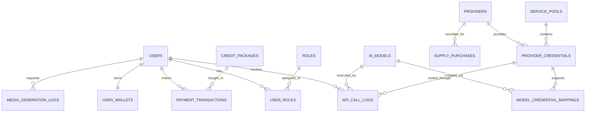

# Thiết Kế Cơ Sở Dữ Liệu PostgreSQL Chuẩn Hóa (Database Schema)

Cơ sở dữ liệu của **VeloX AI Gateway** được thiết kế trên **PostgreSQL 15+**, tuân thủ chuẩn hóa dạng 3NF (Third Normal Form), thiết lập ràng buộc toàn vẹn tham chiếu (Foreign Keys & Constraints) chặt chẽ, hỗ trợ UUID v4 và chỉ mục (Indexing) tối ưu cho hàng triệu bản ghi logs.

---

## 1. Sơ Đồ Thực Thể Liên Kết (Entity-Relationship Diagram - ERD)



---

## 2. Đặc Tả Chi Tiết Các Bảng Dữ Liệu

### 2.1. Phân Hệ Người Dùng & Quyền Hạn (Identity & Access)

```sql
-- 1. Bảng Vai Trò (Roles)
CREATE TABLE roles (
    id VARCHAR(32) PRIMARY KEY, -- 'ROLE_SUPER_ADMIN', 'ROLE_ADMIN', 'ROLE_OPERATOR', 'ROLE_USER'
    name VARCHAR(64) NOT NULL,
    description TEXT,
    created_at TIMESTAMPTZ DEFAULT CURRENT_TIMESTAMP
);

-- 2. Bảng Người Dùng (Users)
CREATE TABLE users (
    id UUID PRIMARY KEY DEFAULT gen_random_uuid(),
    email VARCHAR(255) UNIQUE NOT NULL,
    password_hash VARCHAR(255) NOT NULL,
    full_name VARCHAR(128),
    avatar_url TEXT,
    is_active BOOLEAN DEFAULT TRUE NOT NULL,
    is_verified BOOLEAN DEFAULT FALSE NOT NULL,
    created_at TIMESTAMPTZ DEFAULT CURRENT_TIMESTAMP,
    updated_at TIMESTAMPTZ DEFAULT CURRENT_TIMESTAMP
);

-- 3. Bảng Phân Quyền (User Roles)
CREATE TABLE user_roles (
    user_id UUID REFERENCES users(id) ON DELETE CASCADE,
    role_id VARCHAR(32) REFERENCES roles(id) ON DELETE RESTRICT,
    assigned_at TIMESTAMPTZ DEFAULT CURRENT_TIMESTAMP,
    PRIMARY KEY (user_id, role_id)
);
```

### 2.2. Phân Hệ Pool, API Key & Token Nhà Cung Cấp

```sql
-- 4. Bảng Nhà Cung Cấp (Providers: OpenAI, Anthropic, Midjourney, Runway,...)
CREATE TABLE providers (
    id VARCHAR(64) PRIMARY KEY, -- 'openai', 'anthropic', 'midjourney', 'runway'
    name VARCHAR(128) NOT NULL,
    website VARCHAR(255),
    is_active BOOLEAN DEFAULT TRUE,
    created_at TIMESTAMPTZ DEFAULT CURRENT_TIMESTAMP
);

-- 5. Bảng Nhóm Dịch Vụ (Service Pools)
CREATE TABLE service_pools (
    id UUID PRIMARY KEY DEFAULT gen_random_uuid(),
    name VARCHAR(128) NOT NULL,
    category VARCHAR(32) NOT NULL, -- 'CHAT', 'IMAGE', 'VIDEO', 'DEV_REQ'
    min_active_keys INT DEFAULT 2 NOT NULL, -- Ngưỡng cảnh báo hết key
    routing_strategy VARCHAR(32) DEFAULT 'LEAST_USED', -- 'ROUND_ROBIN', 'LEAST_USED', 'WEIGHTED'
    is_active BOOLEAN DEFAULT TRUE,
    created_at TIMESTAMPTZ DEFAULT CURRENT_TIMESTAMP
);

-- 6. Bảng Thông Tin Xác Thực (Credentials: Vừa API Key, Vừa Token Acc)
CREATE TABLE provider_credentials (
    id UUID PRIMARY KEY DEFAULT gen_random_uuid(),
    pool_id UUID REFERENCES service_pools(id) ON DELETE SET NULL,
    provider_id VARCHAR(64) REFERENCES providers(id) ON DELETE CASCADE,
    auth_type VARCHAR(32) NOT NULL, -- 'API_KEY' (NCC), 'TOKEN_ACCOUNT' (Mua sỉ)
    credential_identifier VARCHAR(128), -- Tên gợi nhớ / Email tài khoản
    secret_value TEXT NOT NULL, -- Khóa API hoặc Bearer Token (được mã hóa ở tầng DB)
    balance_limit NUMERIC(14, 4), -- Số dư tối đa (nếu có)
    balance_remaining NUMERIC(14, 4), -- Số dư còn lại
    error_count INT DEFAULT 0 NOT NULL,
    is_healthy BOOLEAN DEFAULT TRUE NOT NULL,
    last_checked_at TIMESTAMPTZ,
    created_at TIMESTAMPTZ DEFAULT CURRENT_TIMESTAMP
);
```

### 2.3. Danh Mục Model, Định Giá & Biên Lợi Nhuận

```sql
-- 7. Bảng Mô Hình AI (AI Models)
CREATE TABLE ai_models (
    id VARCHAR(64) PRIMARY KEY, -- 'gpt-4o', 'claude-3-5-sonnet', 'flux-pro', 'runway-gen3'
    provider_id VARCHAR(64) REFERENCES providers(id) ON DELETE RESTRICT,
    display_name VARCHAR(128) NOT NULL,
    category VARCHAR(32) NOT NULL, -- 'CHAT', 'IMAGE', 'VIDEO', 'DEV_REQ'
    unit_type VARCHAR(32) NOT NULL, -- 'PER_1K_TOKENS', 'PER_IMAGE', 'PER_SECOND'
    cost_price_usd NUMERIC(10, 6) NOT NULL, -- Giá vốn từ NCC
    selling_price_credits NUMERIC(12, 4) NOT NULL, -- Giá bán tính bằng Credits
    profit_margin_percent NUMERIC(6, 2) NOT NULL, -- Biên lợi nhuận (%)
    is_available BOOLEAN DEFAULT TRUE,
    created_at TIMESTAMPTZ DEFAULT CURRENT_TIMESTAMP
);

-- 8. Bảng Ánh Xạ Model Với Credential
CREATE TABLE model_credential_mappings (
    id UUID PRIMARY KEY DEFAULT gen_random_uuid(),
    model_id VARCHAR(64) REFERENCES ai_models(id) ON DELETE CASCADE,
    credential_id UUID REFERENCES provider_credentials(id) ON DELETE CASCADE,
    account_cost_price NUMERIC(10, 6),
    is_active BOOLEAN DEFAULT TRUE,
    UNIQUE (model_id, credential_id)
);
```

### 2.4. Phân Hệ Ví Tiền, Nạp Tiền & Nguồn Hàng

```sql
-- 9. Bảng Ví Tiền Khách Hàng (User Wallets)
CREATE TABLE user_wallets (
    user_id UUID PRIMARY KEY REFERENCES users(id) ON DELETE CASCADE,
    balance_credits NUMERIC(14, 4) DEFAULT 0.0000 NOT NULL,
    total_deposited_credits NUMERIC(14, 4) DEFAULT 0.0000 NOT NULL,
    total_spent_credits NUMERIC(14, 4) DEFAULT 0.0000 NOT NULL,
    updated_at TIMESTAMPTZ DEFAULT CURRENT_TIMESTAMP
);

-- 10. Bảng Gói Nạp Tiền (Credit Packages)
CREATE TABLE credit_packages (
    id UUID PRIMARY KEY DEFAULT gen_random_uuid(),
    name VARCHAR(128) NOT NULL,
    price_vnd NUMERIC(12, 0) NOT NULL,
    credits_given NUMERIC(14, 4) NOT NULL,
    bonus_percentage INT DEFAULT 0,
    is_popular BOOLEAN DEFAULT FALSE,
    is_active BOOLEAN DEFAULT TRUE,
    created_at TIMESTAMPTZ DEFAULT CURRENT_TIMESTAMP
);

-- 11. Bảng Lịch Sử Nạp Tiền (Payment Transactions)
CREATE TABLE payment_transactions (
    id UUID PRIMARY KEY DEFAULT gen_random_uuid(),
    transaction_code VARCHAR(64) UNIQUE NOT NULL,
    user_id UUID REFERENCES users(id) ON DELETE CASCADE,
    package_id UUID REFERENCES credit_packages(id) ON DELETE SET NULL,
    amount_vnd NUMERIC(12, 0) NOT NULL,
    credits_credited NUMERIC(14, 4) NOT NULL,
    payment_gateway VARCHAR(32) NOT NULL, -- 'BANK_TRANSFER', 'MOMO', 'STRIPE', 'CRYPTO'
    status VARCHAR(32) DEFAULT 'PENDING' NOT NULL, -- 'PENDING', 'SUCCESS', 'FAILED', 'CANCELLED'
    created_at TIMESTAMPTZ DEFAULT CURRENT_TIMESTAMP
);

-- 12. Bảng Quản Lý Chi Phí Nguồn Hàng (Supply Purchases)
CREATE TABLE supply_purchases (
    id UUID PRIMARY KEY DEFAULT gen_random_uuid(),
    provider_id VARCHAR(64) REFERENCES providers(id) ON DELETE RESTRICT,
    title VARCHAR(255) NOT NULL, -- 'Nạp 500$ OpenAI API', 'Mua 10 acc Midjourney sỉ'
    purchase_type VARCHAR(32) NOT NULL, -- 'DIRECT_DEPOSIT', 'BULK_ACCOUNT'
    cost_amount NUMERIC(14, 2) NOT NULL, -- Số tiền thực tế chi trả
    currency VARCHAR(8) DEFAULT 'USD',
    quantity INT DEFAULT 1,
    purchased_at TIMESTAMPTZ NOT NULL,
    note TEXT,
    created_at TIMESTAMPTZ DEFAULT CURRENT_TIMESTAMP
);
```

### 2.5. Phân Hệ Nhật Ký & Kiểm Toán (Audit Logs)

```sql
-- 13. Bảng Log Gọi API (Api Call Logs)
CREATE TABLE api_call_logs (
    id UUID PRIMARY KEY DEFAULT gen_random_uuid(),
    user_id UUID REFERENCES users(id) ON DELETE SET NULL,
    model_id VARCHAR(64) REFERENCES ai_models(id) ON DELETE SET NULL,
    credential_id UUID REFERENCES provider_credentials(id) ON DELETE SET NULL,
    prompt_tokens INT DEFAULT 0,
    completion_tokens INT DEFAULT 0,
    total_credits_charged NUMERIC(12, 4) NOT NULL,
    duration_ms INT NOT NULL,
    status_code INT NOT NULL,
    ip_address VARCHAR(45),
    created_at TIMESTAMPTZ DEFAULT CURRENT_TIMESTAMP
);

-- 14. Bảng Log Tạo Ảnh & Video (Media Generation Logs)
CREATE TABLE media_generation_logs (
    id UUID PRIMARY KEY DEFAULT gen_random_uuid(),
    user_id UUID REFERENCES users(id) ON DELETE SET NULL,
    model_id VARCHAR(64) REFERENCES ai_models(id) ON DELETE SET NULL,
    media_type VARCHAR(16) NOT NULL, -- 'IMAGE', 'VIDEO'
    prompt TEXT NOT NULL,
    output_url TEXT,
    credits_charged NUMERIC(12, 4) NOT NULL,
    render_seconds NUMERIC(8, 2),
    created_at TIMESTAMPTZ DEFAULT CURRENT_TIMESTAMP
);

-- Chiến Lược Indexing Nâng Cao (Performance Optimization)
CREATE INDEX idx_users_email ON users(email);
CREATE INDEX idx_credentials_pool ON provider_credentials(pool_id, is_healthy);
CREATE INDEX idx_api_logs_user_time ON api_call_logs(user_id, created_at DESC);
CREATE INDEX idx_api_logs_model ON api_call_logs(model_id, created_at DESC);
CREATE INDEX idx_payments_user ON payment_transactions(user_id, created_at DESC);
```
