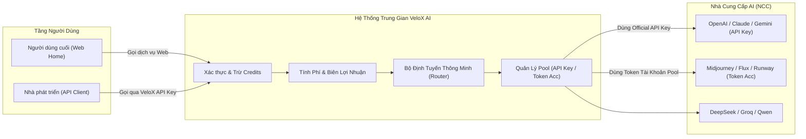

# Tài Liệu Đặc Tả Nghiệp Vụ - VeloX AI Gateway

Hệ thống **VeloX AI Gateway** là nền tảng trung gian (AI Reverse Proxy & Aggregator) đóng vai trò kết nối, chuẩn hóa và tối ưu chi phí phân phối các mô hình Trí Tuệ Nhân Tạo (LLM Chat, Image Gen, Video Gen, Code/Dev AI).

---

## 1. Bài Toán Nghiệp Vụ Cốt Lõi

### 1.1. Hai Cơ Chế Lấy Mô Hình (Model Ingestion)
1. **Kết nối API Key chính thức từ NCC (Official API Key):**
   - Áp dụng cho: OpenAI, Anthropic Claude, Google Gemini, Groq, DeepSeek,...
   - Cơ chế: Cung cấp API Key từ nhà cung cấp -> Hệ thống tự động nhận diện danh sách model hỗ trợ -> Đưa vào danh mục định tuyến.
2. **Khai thác Token từ Account Pool (Session/Bearer Token Scraping/Emulation):**
   - Áp dụng cho: Các dịch vụ bán gói theo tài khoản người dùng hoặc session Web (Midjourney, Runway, Kling, Sora, Cursor, GitHub Copilot token).
   - Cơ chế: Quản lý nhóm tài khoản (Account Pool) -> Tự động trích xuất token/session -> Xoay vòng tải (Round-robin) -> Giúp hạ giá thành sản phẩm xuống mức tối thiểu.

---

## 2. Phân Quyền Truy Cập (Access Control & RBAC)

Hệ thống phân định nghiêm ngặt phạm vi tiếp cận của người dùng:

| Vai Trò (Role) | Trang Home (`/`) | Trang Portal Khách (`/workspace`) | Trang Admin Dashboard (`/admin`) |
| :--- | :---: | :---: | :---: |
| **Guest (Khách vãng lai)** | Xem giới thiệu, bảng giá, tài liệu | Chặn (Yêu cầu đăng nhập) | Chặn hoàn toàn (403/Redirect Home) |
| **User Mới Đăng Ký** | Trải nghiệm dịch vụ, nạp tiền | Dùng thử Playground, xem Credits cá nhân | **CHẶN TUYỆT ĐỐI** (Không thể vào Admin) |
| **Admin / Cấp Sẵn** | Toàn quyền | Toàn quyền | **ĐƯỢC VÀO QUẢN TRỊ TOÀN DIỆN** |

> [!IMPORTANT]
> **Quy tắc bảo mật:** Khách hàng tự đăng ký trên trang Home chỉ được cấp quyền `ROLE_USER`. Họ chỉ tương tác tại trang Home và User Portal (quản lý khóa cá nhân, lịch sử gọi, nạp credits). Dashboard quản trị `/admin` chỉ dành riêng cho tài khoản nội bộ do Super Admin cấp sẵn (`ROLE_ADMIN`, `ROLE_OPERATOR`).

---

## 3. Mô Hình Doanh Thu & Cân Bằng Biên Lợi Nhuận

1. **Credits System:** Mọi giao dịch gọi AI đều quy đổi ra đơn vị Credits nội bộ.
2. **Bảng Giá Động (Dynamic Pricing):**
   $$\text{Giá Bán cho User} = \text{Giá Vốn (NCC)} \times (1 + \% \text{Biên Lợi Nhuận Mong Muốn}) + \text{Phí Khấu Hao Pool}$$
3. **Cảnh Báo Quản Trị:** Tự động cảnh báo khi Pool Key bị cạn kiệt số dư hoặc Token tài khoản bị hết hạn (Revoked/Expired) để tránh gián đoạn dịch vụ của khách.
