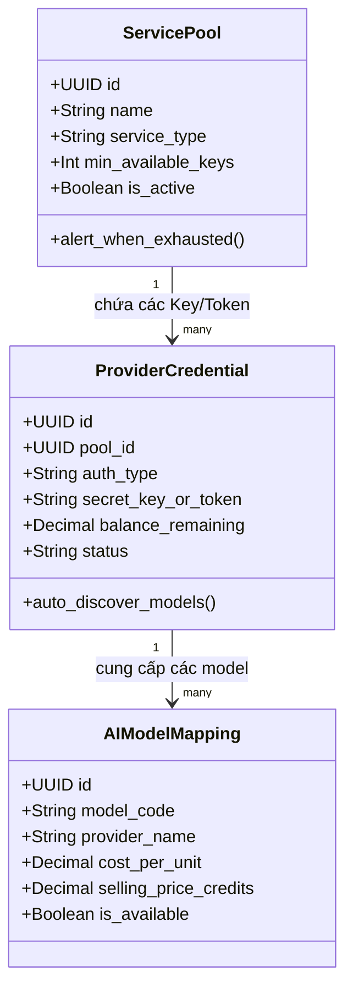

# Đặc Tả Chi Tiết Các Phân Hệ Nghiệp Vụ (Theo Bản Vẽ Thiết Kế)

Tài liệu này chuẩn hóa và cụ thể hóa toàn bộ các ghi chú kỹ thuật từ bản thảo nghiệp vụ quản trị hệ thống **VeloX**.

---

## 1. Phân Hệ Dashboard Quản Trị (Admin Analytics)

Trang tổng quan cung cấp bức tranh tài chính và vận hành kỹ thuật theo thời gian thực:

### 1.1. Thẻ Chỉ Số Trọng Yếu (KPI Cards)
- **Tổng Người Dùng:** Số lượng khách hàng hoạt động (Active / Total).
- **Tổng Doanh Thu Nạp Tiền:** Doanh thu hôm nay, tuần này và tháng này.
- **Tổng Tiêu Thụ Credits:** Lượng credits khách đã tiêu thụ trong ngày.
- **Trạng Thái Pool AI:** Tỷ lệ sống (Health Status) của các Key/Token trong kho.

### 1.2. Biểu Đồ Trực Quan (Interactive Charts)
- **Chart Gói Nạp Khách Mua:** Biểu đồ phân bổ tỷ trọng các gói credits được nạp nhiều nhất.
- **Chart Doanh Thu & Nạp Tiền Theo Ngày:** Doanh thu theo chuỗi thời gian (Time-series).
- **Danh Mục Thống Kê Tiêu Thụ Phân Loại:**
  - 🖼️ **Model Tạo Ảnh:** Số lượt gọi, credits tiêu thụ (Midjourney, Flux, SDXL, DALL-E 3).
  - 🎥 **Model Tạo Video:** Thời lượng render, chi phí vốn (Runway Gen-3, Kling, Luma).
  - 💬 **Model Chat:** Số token prompt/completion (GPT-4o, Claude 3.5 Sonnet, DeepSeek V3/R1).
  - 💻 **Model Request Dành Cho Dev:** Lượng request gọi qua Endpoint chuẩn OpenAI, Cursor token, API latency.

---

## 2. Phân Hệ Quản Lý Dịch Vụ & Pool (Service & Pool Engine)

Đây là **trái tim công nghệ** của nền tảng VeloX AI:

### 2.1. Quản Lý Pool (Pool Management)
- **Chức năng:** Thêm, Sửa, Xoá, Bật/Tắt Pool theo loại dịch vụ (Text, Image, Video).
- **Cơ chế Cân Bằng Tải:** Phân phối request theo thuật toán Round-Robin hoặc Priority Weight.
- **Cảnh báo cạn kiệt (Exhaustion Alert):** Tự động gửi cảnh báo (Telegram/Email/UI) khi số lượng key khả dụng rơi xuống dưới ngưỡng an toàn.

### 2.2. Quản Lý API Key & Token Account (Credentials)
- **API Key Chính Thức:** Nhập khóa NCC (OpenAI/Anthropic) -> Tự động truy vấn metadata để nhận diện toàn bộ danh sách model khả dụng.
- **Token Account Pool:** Khẩu mã/auth session từ các tài khoản mua sỉ -> Trích xuất Bearer token để gọi các model độc quyền.
- **Kiểm Tra Trạng Thái Tự Động (Healthcheck Cron):** Định kỳ gửi ping test để loại bỏ các key lỗi/hết số dư ra khỏi pool định tuyến.

### 2.3. Nhóm Model & Ánh Xạ Theo Tài Khoản
- Nhóm các model theo từng nhà cung cấp và theo giá thành đầu vào của từng tài khoản nạp.
- Cho phép Admin bật/tắt từng model cụ thể hoặc gán model đó vào gói cước tương ứng.

---

## 3. Phân Hệ Quản Lý Gói & Định Giá (Pricing & Profit Margin)

Quản lý doanh thu, định giá linh hoạt và kiểm soát biên độ lãi:

### 3.1. Quản Lý Gói Nạp Tiền (Credit Packages)
- Bảng cấu hình các gói nạp (VD: Gói Khởi Đầu 50,000 VND = 500 Credits, Gói Chuyên Nghiệp 500,000 VND = 6,000 Credits tặng 20% bonus).

### 3.2. Bảng Định Giá Model & Biên Lợi Nhuận
- Hệ thống hỗ trợ công cụ **Cân Bằng Biên Lợi Nhuận**:
  - `Giá Vốn Nhà Cung Cấp`: Tính theo USD/Token hoặc USD/Request.
  - `Hệ Số Nhân (Multiplier)`: Ví dụ x1.3 (lãi 30%) hoặc x1.5 (lãi 50%).
  - `Giá Bán Đề Xuất (Credits)`: Tự động tính toán số credits khách phải trả khi thực hiện 1 request.

---

## 4. Phân Hệ Quản Lý Nguồn Hàng & Chi Phí (Cost & Capital Goods)

Theo dõi chặt chẽ nguồn vốn và chi phí đầu vào:
- **Quản Lý Nguồn Hàng:** Thêm/sửa/xoá các giao dịch mua tài khoản số lượng lớn từ các đối tác hoặc chi phí nạp tiền trực tiếp vào portal NCC.
- **Lịch Sử Nạp Tiền Vào NCC:** Lưu trữ hoá đơn, ngày mua, số tiền đã bỏ ra để hệ thống tính toán chính xác chỉ số hoàn vốn (ROI) và lãi ròng thực tế.

---

## 5. Phân Hệ Log & Giám Sát Chi Tiết (Audit & Observability)

Bảo đảm tính minh bạch và phát hiện gian lận:
- **Log Gọi API Từng User:** Thời gian, User ID, Model gọi, Request/Response payload hash, Tokens sử dụng, Số credits bị trừ, Mã trạng thái (200, 429, 500), Thời gian phản hồi (ms).
- **Log Tạo Ảnh & Video:** Ghi nhận prompt, thông số (kích thước, steps), đường dẫn ảnh/video tạo ra và người dùng sở hữu.
- **Log Lỗi Hệ Thống:** Lưu lại vết khi một key trong pool gặp lỗi 429 (Rate Limit) hoặc 401 (Hết tiền) để tự động chuyển tiếp request sang key dự phòng (Failover).

---

## 6. Phân Hệ Quản Lý Người Dùng & Phân Quyền (User & RBAC)

- **Danh Sách Khách Hàng:** Tra cứu số dư credits, tổng chi tiêu, lịch sử giao dịch.
- **Phân Quyền:** Cấp quyền quản trị viên (`SuperAdmin`, `Operator`, `Finance`) hoặc người dùng thông thường (`StandardUser`).
- **Khóa / Mở Khóa Tài Khoản:** Tạm ngưng các tài khoản có hành vi bất thường (Spam, DDOS).
