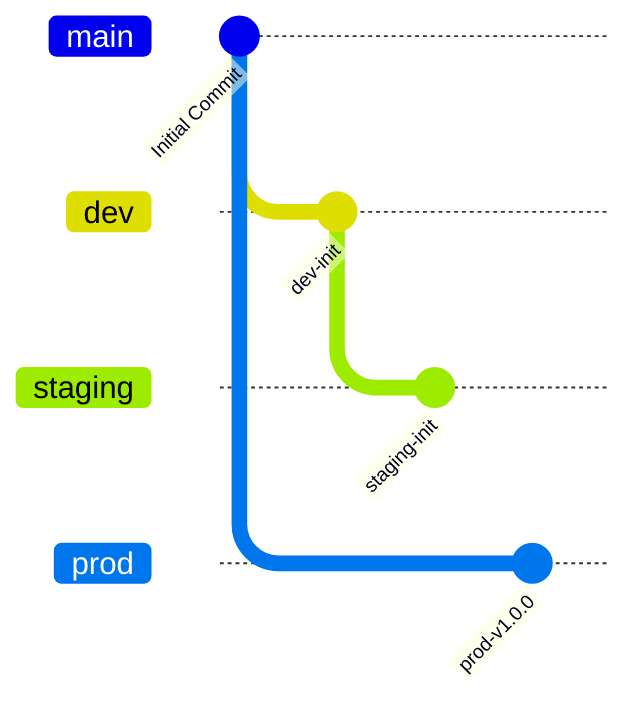
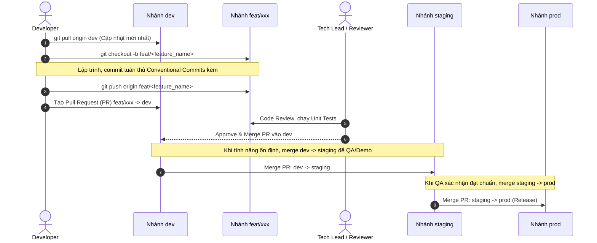
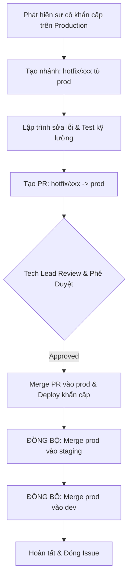

# Quy Trình Phân Phối Nhánh (Gitflow Workflow)

Tài liệu này định nghĩa chi tiết mô hình phân phối nhánh Gitflow chuẩn hóa được áp dụng tại dự án **VeloX**, bao gồm cấu trúc các môi trường, vòng đời phát triển tính năng và quy trình xử lý sự cố khẩn cấp.

---

## 1. Cấu Trúc Repository & 3 Nhánh Chính

Hệ thống mã nguồn của VeloX được phân tầng nghiêm ngặt thành 3 nhánh vĩnh viễn (Long-lived Branches):



| Nhánh | Mục Đích Nghiệp Vụ | Quyền Hạn & Quy Tắc |
| :--- | :--- | :--- |
| **`prod`** | Chứa mã nguồn thực thi trên môi trường **Production**. Chỉ đại diện cho các bản phát hành chính thức đã kiểm định an toàn 100%. | **BẢO VỆ TUYỆT ĐỐI**: Nghiêm cấm push trực tiếp. Chỉ nhận code thông qua Pull Request từ `staging` hoặc `hotfix/*`. Cần tối thiểu 1 Tech Lead approve. |
| **`staging`** | Môi trường tiền sản phẩm (Pre-production), phục vụ kiểm thử chất lượng (QA/QC), kiểm thử nghiệm thu người dùng (UAT) và demo đối tác/khách hàng. | **BẢO VỆ**: Không push trực tiếp. Nhận code từ `dev` khi kết thúc sprint/chu kỳ tính năng hoặc từ `prod` khi đồng bộ hotfix. |
| **`dev`** | Nhánh làm việc trung tâm (Integration Branch) của toàn bộ nhóm phát triển. Nơi hội tụ các tính năng mới trước khi đưa sang kiểm thử. | Cho phép merge từ các nhánh `feat/*` sau khi vượt qua quy trình Code Review. |

---

## 2. Quy Định Đặt Tên Nhánh Tính Năng & Sửa Lỗi

Các nhánh tạm thời (Short-lived Branches) phải tuân thủ tiền tố quy chuẩn:

| Loại Nhánh | Định Dạng Tên | Nhánh Gốc (Base) | Nhánh Đích (Target) | Ví Dụ |
| :--- | :--- | :--- | :--- | :--- |
| **Feature** | `feat/<feature_name>` | `dev` | `dev` | `feat/homepage`, `feat/login_page` |
| **Bugfix thông thường** | `fix/<bug_name>` | `dev` | `dev` | `fix/header_dropdown` |
| **Hotfix khẩn cấp** | `hotfix/<hotfix_name>` | `prod` | `prod` | `hotfix/fix_login_error` |
| **Release** | `release/v<version>` | `dev` | `staging` & `prod` | `release/v1.0.0` |

---

## 3. Quy Trình Phát Triển Tính Năng Mới (Feature Workflow)

Quy trình phát triển một tính năng mới diễn ra qua 6 bước khép kín:



### Các Bước Chi Tiết:
1. **Khởi tạo nhánh:** Tạo nhánh `feat/<feature_name>` bắt đầu từ nhánh `dev` mới nhất:
   ```bash
   git checkout dev
   git pull origin dev
   git checkout -b feat/homepage
   ```
2. **Làm việc & Commit:** Viết code, thêm unit tests, commit theo chuẩn kèm Issue ID:
   ```bash
   git add .
   git commit -m "feat: add homepage hero section and navigation #101"
   ```
3. **Đẩy lên Remote:** Push nhánh feature lên máy chủ GitHub:
   ```bash
   git push origin feat/homepage
   ```
4. **Tạo Pull Request (PR):**
   - Base branch: `dev`
   - Compare branch: `feat/homepage`
   - Điền đầy đủ mô tả theo PR Template (nêu rõ Issue ID, giải pháp, bằng chứng test).
5. **Review & Merge vào `dev`:**
   - Ít nhất 1 reviewer phê duyệt và các bài kiểm tra tự động (CI) pass.
   - Thực hiện merge PR vào `dev` (khuyến nghị giữ merge commit hoặc squash theo chính sách dự án).
6. **Đưa lên Staging để QA:**
   - Khi tập hợp đủ các tính năng trong Sprint, tạo PR hợp nhất từ `dev` vào `staging`.
   - Đội ngũ QA tiến hành kiểm thử toàn diện trên môi trường Staging.
7. **Triển khai Production (`prod`):**
   - Khi Staging pass toàn bộ bài kiểm tra UAT, tạo PR hợp nhất từ `staging` vào `prod`.
   - Gắn git tag phiên bản (ví dụ: `v1.0.0`) và kích hoạt pipeline deploy tự động.

---

## 4. Quy Trình Xử Lý Sự Cố Khẩn Cấp (Hotfix Workflow)

Hotfix là các bản sửa lỗi **nghiêm trọng và khẩn cấp** xảy ra trực tiếp trên môi trường Production (như lỗi bảo mật, sập hệ thống thanh toán, treo đăng nhập) cần giải quyết ngay lập tức mà không thể đợi chu kỳ release thông thường từ `dev`.

### 4.1. Quy Trình Xử Lý 5 Bước:



### 4.2. Thao Tác Kỹ Thuật Từng Bước:

1. **Tạo nhánh hotfix từ `prod`:**
   ```bash
   git checkout prod
   git pull origin prod
   git checkout -b hotfix/fix_login_error
   ```
2. **Sửa lỗi & Commit:**
   ```bash
   git add .
   git commit -m "fix: resolve critical null pointer in auth service #105"
   git push origin hotfix/fix_login_error
   ```
3. **Mở PR vào `prod` & Phê duyệt:**
   - Mở PR từ `hotfix/fix_login_error` vào `prod`.
   - Đội ngũ Tech Lead review khẩn cấp và tiến hành merge.
4. **Đồng bộ ngược vào `staging` và `dev` (CỰC KỲ QUAN TRỌNG):**
   - **Mục đích:** Đảm bảo bản vá lỗi được cập nhật ngay lập tức vào tất cả các môi trường, tránh tình trạng lần release tiếp theo từ `dev` đè mất bản vá gây tái phát lỗi.
   ```bash
   # Đồng bộ vào staging
   git checkout staging
   git pull origin staging
   git merge prod -m "chore: sync hotfix #105 from prod into staging"
   git push origin staging

   # Đồng bộ vào dev
   git checkout dev
   git pull origin dev
   git merge prod -m "chore: sync hotfix #105 from prod into dev"
   git push origin dev
   ```
5. **Dọn dẹp:** Xoá nhánh hotfix sau khi đã merge hoàn tất:
   ```bash
   git branch -d hotfix/fix_login_error
   git push origin --delete hotfix/fix_login_error
   ```
